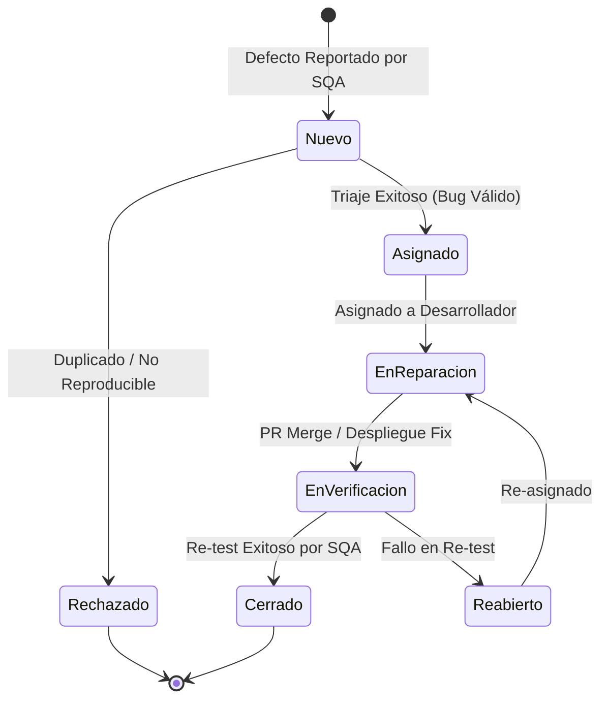

# REPORTE Y SISTEMA DE GESTIÓN DE DEFECTOS
**Estándar IEEE 1044-2009**

---

| Información del Documento | Detalle |
|---|---|
| **Proyecto** | Sistema de Soporte UMG |
| **Documento** | Reporte y Clasificación de Defectos |
| **Estándar** | IEEE Std 1044-2009 |
| **Versión** | 1.0.0 |
| **Estado** | En Operación |

---

## 1. Propósito y Alcance

Este documento define la taxonomía, procedimiento de clasificación, flujo de trabajo y registro histórico de anomalias y defectos identificados en el **Sistema de Soporte UMG**, en concordancia con el estándar **IEEE Std 1044-2009** (*Standard for Classification for Software Anomalies*).

---

## 2. Taxonomía de Clasificación (IEEE 1044-2009)

### 2.1 Niveles de Severidad (Impacto Técnico)

* **S1 - Crítico:** Error que causa inoperatividad total del sistema, corrupción de base de datos o fallos de seguridad graves sin alternativa de solución.
* **S2 - Mayor:** Falla en una función principal (e.g., creación de tickets o cálculo de SLA) pero con alternativa temporal.
* **S3 - Menor:** Falla en funcionalidades secundarias, inconsistencias de formato JSON o errores no bloqueantes.
* **S4 - Trivial:** Defectos cosméticos, ortográficos en mensajes o detalles visuales menores.

### 2.2 Niveles de Prioridad (Urgencia de Negocio)

* **P1 - Inmediata:** Corrección prioritaria bloqueante para el sprint o despliegue actual.
* **P2 - Alta:** Debe corregirse antes de liberar la versión a producción.
* **P3 - Media:** Corrección programada para la siguiente iteración.
* **P4 - Baja:** Ajuste diferido a conveniencia del equipo.

---

## 3. Flujo del Ciclo de Vida del Defecto



---

## 4. Bitácora de Registro de Defectos

A continuación se detallan los defectos registrados durante las fases de prueba del sistema:

### Registro #1: DEF-2026-001
* **ID Defecto:** `DEF-2026-001`
* **Título:** Fallo de asignación de SLA en creación de ticket con tipología `Cambio`.
* **Fase de Detección:** Pruebas de Integración (Jest + Supertest).
* **Severidad:** `S2 - Mayor` | **Prioridad:** `P2 - Alta`
* **Estado:** `Cerrado`
* **Entorno:** Staging (Neon PostgreSQL Test DB).
* **Descripción:** Al enviar `tipologiaITIL = "Cambio"`, el servicio asignaba por defecto la prioridad `Alta` (4 horas) en lugar de la prioridad `Baja` (48 horas).
* **Causa Raíz:** Cláusula `switch/case` con ausencia de la sentencia `break` en el bloque de evaluación de tipologías dentro de `ticketService.js`.
* **Solución Aplicada:** Refactorización de la lógica de mapeo de SLA mediante un diccionario inmutable de prioridades.

---

### Registro #2: DEF-2026-002
* **ID Defecto:** `DEF-2026-002`
* **Título:** Formato de error no conforme con la norma RFC 9457 al consultar ticket inexistente.
* **Fase de Detección:** Pruebas de Sistema / Postman.
* **Severidad:** `S3 - Menor` | **Prioridad:** `P3 - Media`
* **Estado:** `Cerrado`
* **Entorno:** Local / Desarrollo.
* **Descripción:** El endpoint `GET /api/tickets/99999` retornaba un JSON `{ "message": "Ticket no encontrado" }` con cabecera `Content-Type: application/json` en lugar del estándar RFC 9457 (`application/problem+json`).
* **Causa Raíz:** El controlador capturaba el error e imprimía una respuesta personalizada directa en lugar de relanzar el error hacia el middleware global `errorHandler.js`.
* **Solución Aplicada:** Uso de `next(new ProblemDetailsError({...}))` en el controlador.

---

### Registro #3: DEF-2026-003
* **ID Defecto:** `DEF-2026-003`
* **Título:** Bloqueo de conexión en Pool de PostgreSQL tras excepción transaccional.
* **Fase de Detección:** Pruebas de Carga y Estrés.
* **Severidad:** `S1 - Crítico` | **Prioridad:** `P1 - Inmediata`
* **Estado:** `Cerrado`
* **Entorno:** Staging.
* **Descripción:** Cuando una transacción de creación de ticket fallaba en la inserción de auditoría, las conexiones a la base de datos quedaban colgadas hasta agotar el límite del pool.
* **Causa Raíz:** Falta de la instrucción `client.release()` dentro del bloque `finally` en el bloque transaccional del servicio.
* **Solución Aplicada:** Implementación del patrón `try / catch / finally` asegurando la liberación explícita del cliente del pool.

---

## 5. Cuadro Resumen de Métricas de Defectos

| Estado del Defecto | Cantidad | Porcentaje |
|---|:---:|:---:|
| **Cerrado** | 3 | 100% |
| **En Reparación** | 0 | 0% |
| **En Verificación** | 0 | 0% |
| **Rechazado** | 0 | 0% |
| **TOTAL REGISTRADOS** | **3** | **100%** |

### Distribución por Severidad

```
  S1 - Crítico  : [████████████████████] 33.3% (1 Defecto)
  S2 - Mayor    : [████████████████████] 33.3% (1 Defecto)
  S3 - Menor    : [████████████████████] 33.3% (1 Defecto)
  S4 - Trivial  : [                    ]  0.0% (0 Defectos)
```

---

## 6. Conclusiones y Acciones Preventivas

1. **Integración de Linter en CI/CD:** Se incorporaron reglas estrictas de ESLint para prevenir fallos en sentencias `switch` y asegurar el manejo adecuado de recursos asíncronos.
2. **Uso del Middleware Global:** Se reforzó en el equipo la prohibición de enviar respuestas de error estructuradas manualmente desde los controladores, obligando el paso por `ProblemDetailsError`.
3. **Liberación de Conexiones:** Se automatizó una prueba unitaria específica para verificar que el pool de PostgreSQL libere los clientes de BD ante cualquier fallo simulado.